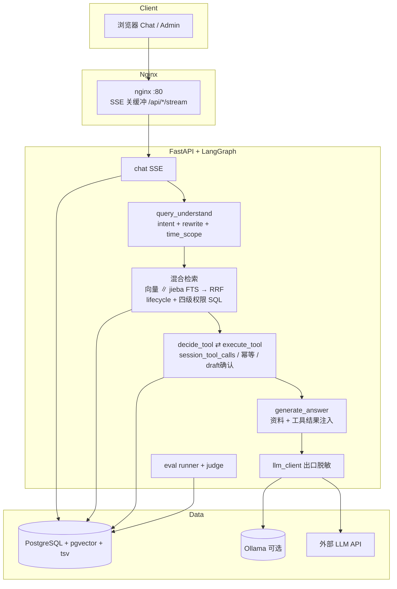
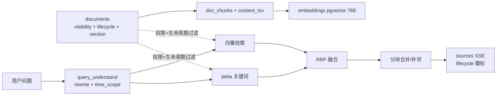

# WorkPilot v2 — 企业员工事务办理 Agent

面向企业员工的事务办理 Agent：能查制度、能算额度、能办申请、能走审批、可全程回溯。基于 FastAPI + LangGraph + PostgreSQL/pgvector。

- **RAG 制度问答**：四级文档权限 + 生命周期（现行/旧版/草案）在同一条 SQL 内过滤；向量 + 关键词 RRF
- **企业工具调用**：权限 + 幂等 + 审计 + 会话内工具记忆；LLM 决策解释，数值校验由代码完成
- **事务办理闭环**：报销预审 → 缺信息追问 → 人工确认 → 提交 → 部门审批
- **可观测与可回归**：节点级 trace、golden case 评测、LLM-as-judge、知识缺口反馈

完整需求见 [docs/业务场景设计.md](docs/业务场景设计.md) · [docs/答案质量与文档生命周期需求.md](docs/答案质量与文档生命周期需求.md)。

---

## 5 分钟跑通（干净 clone）

**前置**

| 依赖 | 说明 |
|---|---|
| Docker | PostgreSQL（compose 或本机） |
| Python 3.11+ / uv | 后端 |
| Node 18+ | 前端 |
| Ollama（可选） | 本地模型；**默认推荐外部 API**（`llm_provider: openai_compatible` + `OPENAI_API_KEY`） |

**模型路径**

| 模式 | 配置 | 说明 |
|---|---|---|
| 外部 API（默认） | `config.yaml` `llm_provider: openai_compatible` + `.env` `OPENAI_API_KEY` | 演示/开发更快；出口自动脱敏 |
| 离线 / 数据不出网 | `llm_provider: ollama` | 本地演示可用 `qwen2.5:3b`；embedding 建议 `nomic-embed-text` |

**Ollama 拉模型（若走本地，首次约 5–15 分钟，视带宽）：**

```bash
ollama pull nomic-embed-text
ollama pull qwen2.5:3b    # 演示；质量更高用 qwen2.5:7b
```

**启动**

```powershell
# 在 v2/ 目录
.\dev.ps1 start
# 或手动：
# docker compose up -d postgres
cd backend
uv sync
copy .env.example .env   # 填 JWT_SECRET_KEY / DATABASE_URL / 可选 OPENAI_API_KEY
uv run alembic upgrade head
uv run python scripts/seed_admin.py
uv run python scripts/seed_demo.py
uv run python scripts/seed_eval_cases.py
# Windows：用 uvicorn（gunicorn 依赖 Unix fcntl，Windows 无法启动）
uv run uvicorn main:app --host 127.0.0.1 --port 8000 --reload
# Linux / Docker 生产：
# uv run gunicorn -k uvicorn.workers.UvicornWorker -w 4 main:app -b 0.0.0.0:8000

cd ../frontend
npm install
npm run dev
```

| 地址 | 说明 |
|---|---|
| http://localhost:5173 | 前端 |
| http://localhost:8000/docs | Swagger |
| http://localhost:8000/health | 健康检查 |

**演示账号**（`seed_demo.py`，密码 `Demo@12345`）：

| 用户 | 角色 | 用途 |
|---|---|---|
| zhangsan | employee / senior 研发 | 报销超标特批 |
| rdadmin | dept_admin 研发 | 审批 / 工单 / 可见 draft |
| admin | super_admin | 管理后台 + 评测 Tab |

**5 分钟验收路径：** 登录 zhangsan → 提问「出差住宿标准是多少」→ 看引用卡片（含生命周期徽标）→ 「帮我预审差旅住宿 2000 元 4 天」→ 确认卡 → rdadmin 后台审批。

---

## 系统架构



### 数据流（文档 → 检索）



---

## 技术栈

| 层 | 技术 |
|---|---|
| 后端 | Python 3.11+ · FastAPI · uv · Gunicorn 模式见架构文档 |
| Agent | LangGraph 多步工具循环 + checkpointer 就绪 |
| 数据库 | PostgreSQL 14+ + pgvector + tsvector（jieba） |
| 模型 | Ollama（qwen2.5:7b / nomic-embed-text）或 OpenAI 兼容 API |
| 前端 | React + Ant Design + Vite |
| 配置 | `backend/config.yaml` + `backend/.env` |

---

## 功能状态（2026-09-20）

| 功能 | 状态 |
|---|---|
| 认证 / 三级角色 / 部门 / 文档管理 | ✅ |
| 文档生命周期 effective/superseded/draft + 版本链 | ✅ Q1 |
| RAG + SSE + 引用 + 生命周期徽标 | ✅ |
| 混合检索 RRF + 查询改写 + time_scope | ✅ |
| 多轮工具决策 session_tool_calls + draft 复用 | ✅ Q2 |
| 场景 A 报销预审→确认→审批 | ✅ |
| 场景 B IT 工单闭环 | ✅ |
| 场景 C 知识缺口 + 反馈 | ✅ |
| 场景 D 四级可见性 seed | ✅ |
| 节点级 trace + 管理后台 | ✅ |
| 评测 82 case + eval_runs + 评测 Tab | ✅ Q3/Q4 |
| LLM-as-judge（faithfulness/points/hallu） | ✅ Q3 |
| R5 重排 | ⏸ 门控不触发（topic mrr=1.0） |

---

## 评测

### 基线（诚实数字）

| 阶段 | doc_hit@3 | mrr | historical | topic mrr | faithfulness | points | hallu |
|---|---|---|---|---|---|---|---|
| Q 前（72 case） | 0.842 | 0.648 | — | — | — | — | — |
| Q1/Q2 后（82 case） | 0.844 | 0.669 | 1.000 | 1.000 | — | — | — |
| Q3 judge 第一轮 | — | — | — | — | 3.36 | 0.674 | 45 |
| Q3 修复后 | — | — | — | — | **3.80** | **0.791** | **27** |

E4 对照：纯向量 mrr 0.38 → 混合 RRF 0.60（检索子集）。细节见 [docs/检索链路升级需求.md](docs/检索链路升级需求.md) 与 [docs/答案质量与文档生命周期需求.md](docs/答案质量与文档生命周期需求.md)。

### 如何跑

```powershell
cd backend
uv run python scripts/seed_eval_cases.py

# 快速指标（不生成答案）
uv run python -c "import asyncio;from eval.runner import run_eval;print(asyncio.run(run_eval()))"

# Judge（生成 + 裁判）
uv run python scripts/experiments/run_q3_judge.py

# 或 UI：管理后台 → 超管 →「评测」→ 运行评测（fast/judge）→ 看历史 / Diff
```

API：

```
POST /api/eval/run?mode=fast|judge&label=...
GET  /api/quality/runs
GET  /api/quality/runs/{id}
GET  /api/quality/runs/{id}/diff?other_id=
GET  /api/quality/eval-cases
POST /api/quality/eval-cases
PATCH /api/quality/eval-cases/{case_id}
```

实验脚本：`backend/scripts/experiments/`（`run_quota_ab.py`、`run_q3_judge.py`、`smoke_hybrid.py` 等）。

---

## 工具一览

| 工具 | 类型 |
|---|---|
| query_employee_profile | 读 DB，员工只能查自己 |
| query_reimbursement_limit | 读 DB 额度 |
| precheck_reimbursement | 纯代码算超标/额度 |
| submit_reimbursement_request | 写 + 幂等 + draft 确认 + 会话内复用 |
| query_my_reimbursements | 我的报销进度 |
| create_it_ticket / query_my_tickets | IT 工单 |

---

## 设计决策（一句话）

| 决策 | 文档 |
|---|---|
| pgvector 与业务同库，权限过滤进同一条 SQL | [docs/系统架构.md](docs/系统架构.md) |
| Embedding 全局唯一模型，切换需全量重向量化 | 同上 |
| LLM 只决策/解释，数值与规则由代码校验 | [CLAUDE.md](../CLAUDE.md) / 业务场景设计 |
| 写操作必须 `requires_confirmation` + 幂等 | [docs/API文档.md](docs/API文档.md) |
| 外部 LLM 仅出口脱敏（R0） | [docs/检索链路升级需求.md](docs/检索链路升级需求.md) |
| 混合 RRF 有效；kw 配额与 R5 重排默认关（门控） | 同上 + 答案质量文档 |
| 文档 lifecycle 与 status 正交：pipeline vs 业务 | [docs/答案质量与文档生命周期需求.md](docs/答案质量与文档生命周期需求.md) |
| draft 文档对员工不召回且不透露存在 | 同上 |
| Judge 证据含工具结果，否则业务数字被误判为编造 | 同上 Q3 |

---

## 文档索引

| 文档 | 说明 |
|---|---|
| [docs/API文档.md](docs/API文档.md) | 接口、SSE、错误码 |
| [docs/业务场景设计.md](docs/业务场景设计.md) | 场景与进度 |
| [docs/答案质量与文档生命周期需求.md](docs/答案质量与文档生命周期需求.md) | Q1–Q6 与评测附录 |
| [docs/检索链路升级需求.md](docs/检索链路升级需求.md) | R0–R5 与 E4/E5 |
| [docs/系统架构.md](docs/系统架构.md) | 架构约束 |
| [docs/数据库设计.md](docs/数据库设计.md) | 表设计 |

---

## 配置

| 文件 | 内容 |
|---|---|
| `backend/config.yaml` | LLM、检索 top_k、限流等 |
| `backend/.env` | JWT、DATABASE_URL、OPENAI_API_KEY |

优先级：环境变量 > `.env` > `config.yaml` > 代码默认值。

---

## 性能与可靠性

- 压测脚本与表格模板：[docs/性能基线.md](docs/性能基线.md)（数字本机填写）
- LLM：指数退避重试、provider 熔断、外部→本地降级、并发 `queued` SSE；配置见 `config.yaml`（`llm_*`）
- 定时任务：APScheduler + PostgreSQLJobStore（cleanup / 部门日报）
- Prompt 版本：`backend/prompts/`，`eval_runs.prompt_set_version` / trace 可对比
- 安全与威胁模型：[docs/安全设计.md](docs/安全设计.md)
- 进度唯一入口：[docs/STATUS.md](docs/STATUS.md)

## 在线演示

⬜ 待部署：docker compose + 外部 API + `seed_demo`；演示账号只读。录屏素材路径见 STATUS / 生产就绪需求 P8。

---

## Roadmap

- 运维监控 Agent、客服 Agent（仅规划，本阶段不实现）
- 提示注入防御、会话记忆摘要、成本看板（P2）
- 万级语料 HNSW 策略与 EXPLAIN
- R5 重排 sidecar（门控触发后再做）

---

## 演示材料

| 材料 | 状态 |
|---|---|
| 架构图（本 README Mermaid） | ✅ |
| 数据流图 | ✅ |
| 场景 A 对话 GIF（≤40s） | ⬜ 需本地录屏：预审超标→追问→确认卡→提交→rdadmin 审批 |
| 场景 D 同题不同答截图 | ⬜ zhangsan vs 客服员工问同一制度（权限差异） |

录屏建议：浏览器 1280×720，GIF ≤40s，放到 `docs/assets/` 并在本节链接。
